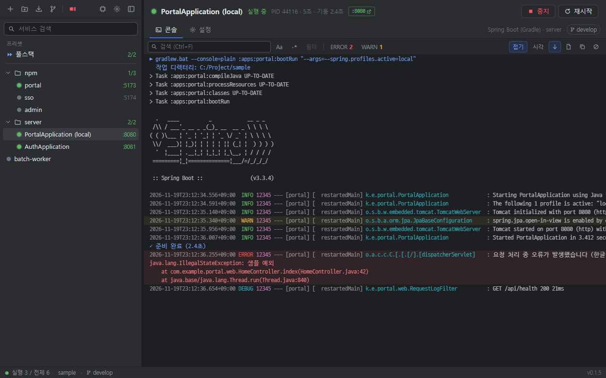
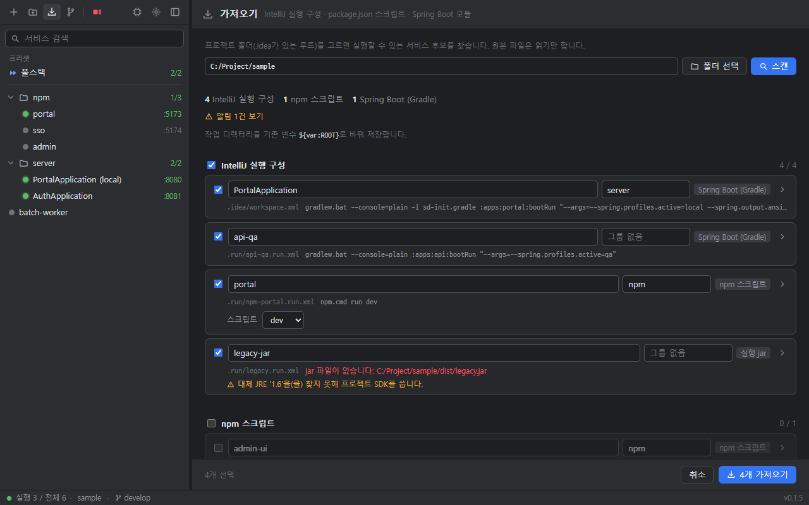
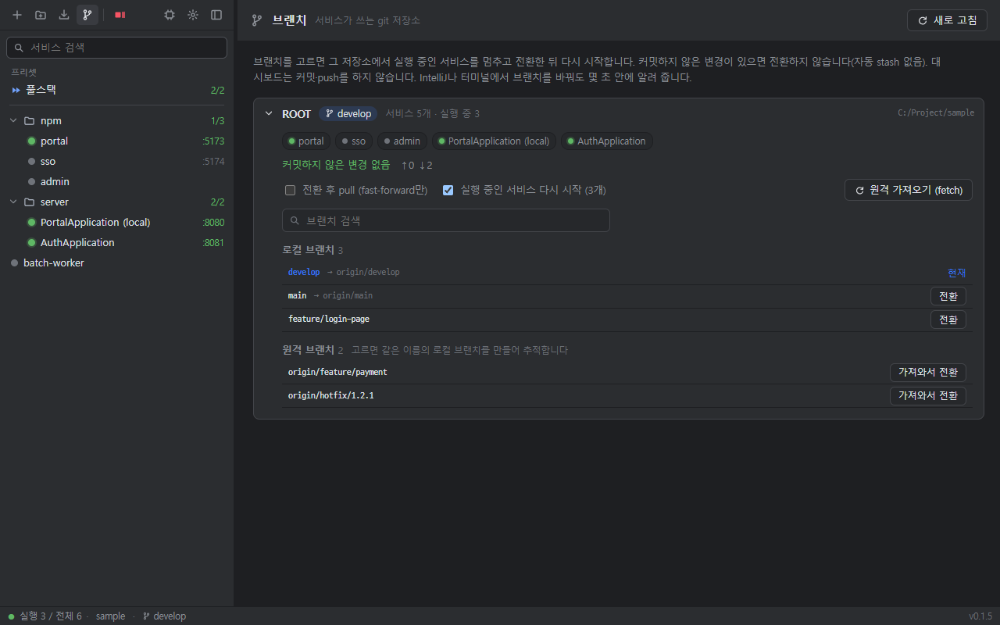

# Services Dashboard

**로컬 개발 서비스를 한 화면에서 띄우고, 멈추고, 로그를 보는 가벼운 Windows 앱**

[**⬇ 다운로드**](https://github.com/hulbo/ServicesDashboard/releases/latest) · [사용 설명서](docs/MANUAL.md) · [릴리스 노트](https://github.com/hulbo/ServicesDashboard/releases)

## Services Dashboard는

Spring Boot(Gradle·Maven), Node(npm·yarn·pnpm), jar, 임의 명령으로 된 개발 서비스를 등록해 두고 **클릭 한 번으로 실행·중지·재시작**하는 데스크톱 앱입니다.

- IntelliJ의 Services 탭처럼 왼쪽에는 서비스 트리, 오른쪽에는 서비스별 콘솔 로그를 보여 줍니다.
- IDE를 켜지 않아도 되고, IntelliJ 실행 구성을 그대로 가져오므로 따로 설정할 것이 거의 없습니다.
- 설치 파일은 약 3MB이고, 설정은 내 PC에만 저장됩니다.

## 주요 기능

| 기능 | 설명 |
|---|---|
| **설정 가져오기** | 프로젝트 폴더를 고르면 IntelliJ 실행 구성, `package.json` 스크립트, Spring Boot 모듈, VS Code `launch.json`을 찾아 서비스로 만듭니다 |
| **한 번에 실행·중지** | 그룹·프리셋 단위 실행, 의존 순서 실행, 자동 재시작, 디버그 모드. 중지하면 자식 프로세스까지 확실히 종료합니다 |
| **보기 좋은 콘솔** | ANSI 색상, 한글 인코딩 자동 판별, ERROR·WARN 필터, 스택트레이스 접기, 검색, 여러 서비스를 합친 통합 로그 |
| **준비·포트 감지** | `Started …` 로그·포트·헬스 URL로 준비 완료를 판단하고, 로그의 주소를 클릭해 엽니다. 포트가 겹치면 점유한 프로세스를 알려 줍니다 |
| **git 브랜치 전환** | 브랜치를 고르면 그 저장소의 서비스를 멈추고, 전환하고, 다시 시작합니다. IntelliJ·터미널에서 바꾼 브랜치도 감지합니다 |
| **JDK·Node 버전 지정** | PC의 JDK·Node·Maven을 찾아 서비스별로 지정합니다 (`17`, `20` 같은 버전 별칭 가능) |
| **트레이 상주** | 창을 닫아도 서비스는 계속 실행됩니다. 트레이에서 시작·중지하고, 비정상 종료는 알림으로 알려 줍니다 |
| **소스 수정 없음** | `build.gradle`·`pom.xml`을 고치지 않고 실행 옵션을 넣습니다 |

## 설치

1. **[최신 릴리스](https://github.com/hulbo/ServicesDashboard/releases/latest)**에서 `ServicesDashboard_<버전>_x64-setup.exe`를 받아 실행합니다.
2. SmartScreen이 막으면 **추가 정보 → 실행**을 누릅니다 (코드 서명이 없는 설치본입니다).

Windows 10/11 x64에서 동작하며 관리자 권한은 필요 없습니다. v0.1.11부터는 새 버전이 나오면 앱 아래 상태 표시줄에 **업데이트** 버튼이 나타나고, 누르면 앱 안에서 받아 설치합니다(설정은 그대로 남습니다).

## 빠르게 시작하기

1. 왼쪽 위 **가져오기**(⤓)를 누르고 프로젝트 폴더를 골라 **스캔**합니다.
2. 쓸 서비스를 체크하고 **가져오기**를 누릅니다.
3. 트리에서 서비스를 더블클릭하면 실행되고, 오른쪽에 로그가 나옵니다.

서비스를 직접 추가하는 방법, 실행 타입, 환경변수, 단축키는 [사용 설명서](docs/MANUAL.md)에 있습니다.

## 화면

| 프로젝트에서 가져오기 | git 브랜치 전환 |
|---|---|
|  |  |

## 문서

| 문서 | 내용 |
|---|---|
| [사용 설명서](docs/MANUAL.md) | 설치, 화면 구성, 서비스 등록, 실행·콘솔·환경변수·브랜치, 설정 파일, 단축키, 문제 해결 |
| [릴리스 노트](https://github.com/hulbo/ServicesDashboard/releases) | 버전별 변경 사항과 설치 파일 |
| [개발 가이드](docs/DEVELOPMENT.md) | 직접 빌드하기, 테스트, 코드 구조 |
| [기획서](docs/PLANNING.md) | 만든 배경, 목표, 설계 |

버그나 제안은 [Issues](https://github.com/hulbo/ServicesDashboard/issues)에 남겨 주세요.

## 라이선스

[MIT](LICENSE)
