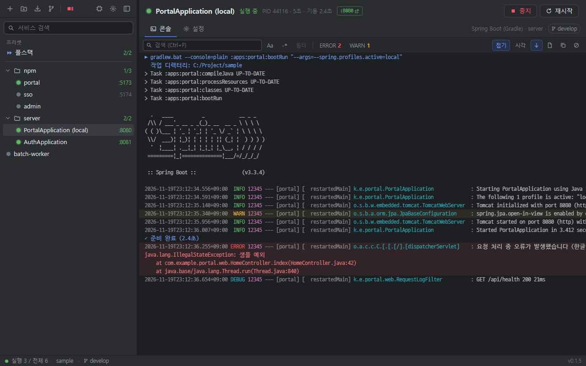
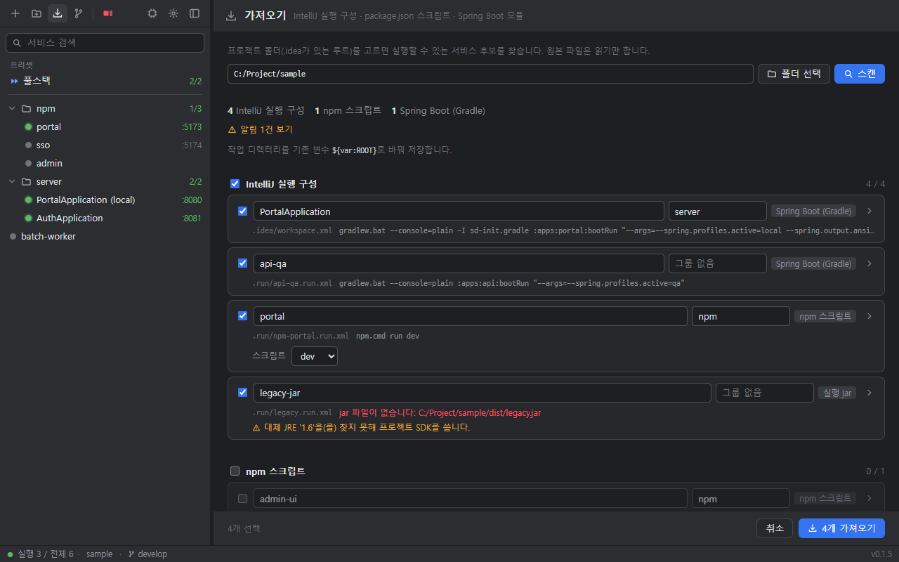
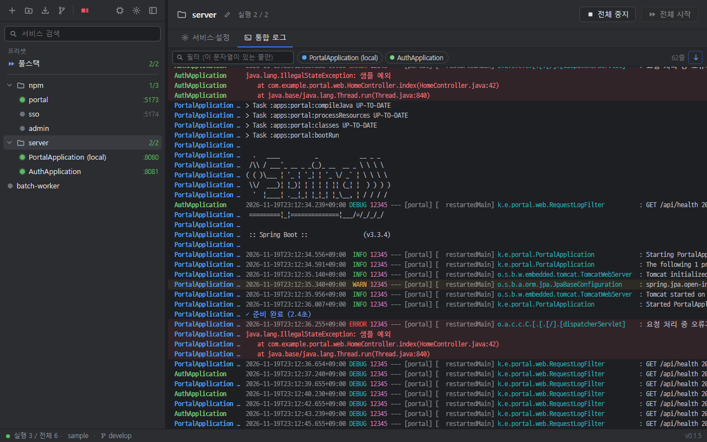
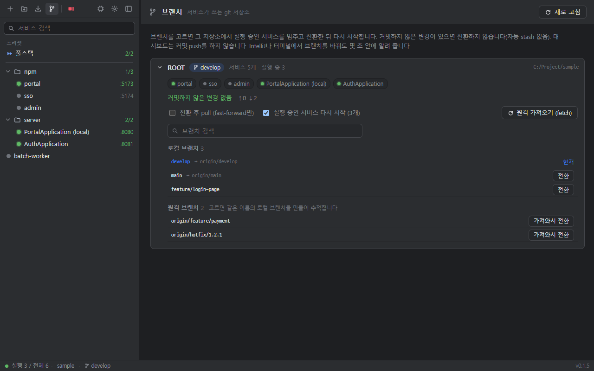

# Services Dashboard 사용 설명서

Services Dashboard로 서비스를 등록하고, 실행하고, 로그를 보는 방법을 설명합니다. 앱 소개와 다운로드는 [README](../README.md)를 보세요.

## 목차

1. [설치와 업데이트](#1-설치와-업데이트)
2. [화면 구성](#2-화면-구성)
3. [서비스 등록하기](#3-서비스-등록하기)
4. [실행하고 멈추기](#4-실행하고-멈추기)
5. [콘솔 로그](#5-콘솔-로그)
6. [환경변수와 변수](#6-환경변수와-변수)
7. [git 브랜치 바꾸기](#7-git-브랜치-바꾸기)
8. [런타임 (JDK·Node·Maven)](#8-런타임-jdknodemaven)
9. [앱 설정](#9-앱-설정)
10. [설정 파일과 팀 공유](#10-설정-파일과-팀-공유)
11. [단축키](#11-단축키)
12. [문제 해결과 알려진 제한](#12-문제-해결과-알려진-제한)

---

## 1. 설치와 업데이트

| 항목 | 내용 |
|---|---|
| 지원 OS | Windows 10 / 11 (x64) |
| 필요한 것 | WebView2 런타임 (Windows 11은 기본 포함, 없으면 설치 중에 받음). 실행할 서비스에 필요한 JDK·Node·Maven 등은 PC에 있어야 합니다 |
| 설치 위치 | `%LOCALAPPDATA%\Services Dashboard\` (현재 사용자용, 관리자 권한 필요 없음) |
| 설정 위치 | `%APPDATA%\ServicesDashboard\` |

**설치**

1. [Releases](https://github.com/hulbo/ServicesDashboard/releases/latest)에서 `ServicesDashboard_<버전>_x64-setup.exe`를 받아 실행합니다.
2. 코드 서명이 없는 설치본이라 SmartScreen이 막으면 **추가 정보 → 실행**을 누릅니다.
3. 설치가 끝나면 시작 메뉴와 바탕화면에 **Services Dashboard** 바로가기가 생깁니다(v0.1.12부터는 바탕화면 바로가기를 늘 만듭니다). 앱 안 업데이트는 바탕화면 바로가기를 한 번만 만들고, 지운 바로가기를 업데이트할 때마다 되살리지는 않습니다.

**업데이트** (v0.1.11부터)

- 앱을 켜면 새 버전이 있는지 확인하고, 있으면 아래 상태 표시줄 오른쪽에 **v<버전> 업데이트** 버튼이 나타납니다. 켜 둔 동안에도 6시간마다 다시 확인합니다.
- 버튼을 누르면 묻는 창이 뜨고, 확인하면 설치본을 받아 서명을 확인한 뒤 설치합니다. 앱이 잠시 꺼졌다가 새 버전으로 다시 켜집니다.
- 실행 중인 서비스는 설치 전에 중지됩니다(묻는 창에 개수가 나옵니다). 다시 켜진 뒤 필요한 서비스를 시작하세요.
- **설정 → 업데이트**에서 *지금 확인*으로 직접 확인하거나, *앱을 켤 때 새 버전 확인*을 끌 수 있습니다.
- 받은 설치본은 앱에 들어 있는 공개 키로 서명을 확인하므로, 이 저장소에서 만든 파일이 아니면 설치하지 않습니다.
- v0.1.10 이하에서는 이 기능이 없으므로 새 설치본을 한 번 직접 덮어 설치해야 합니다. 서비스 목록과 설정은 그대로 남습니다.

**제거**: Windows 설정 → 앱에서 *Services Dashboard*를 제거합니다. 설정 폴더(`%APPDATA%\ServicesDashboard\`)는 남으므로 완전히 지우려면 직접 삭제합니다.

## 2. 화면 구성



| 영역 | 내용 |
|---|---|
| 왼쪽 위 도구 모음 | 서비스 추가(+) · 그룹 추가 · 가져오기(⤓) · 브랜치(⑂) · 전체 중지(■) · 런타임 · 설정 · 워크스페이스 설정. 사이드바가 좁으면 들어가지 않는 버튼은 **⋯(더 보기)** 메뉴로 옮겨집니다 |
| 서비스 트리 | 프리셋, 그룹(폴더), 서비스. 상태 아이콘과 포트(또는 종료 코드)를 표시합니다. 끌어서 순서·그룹을 바꾸고, 우클릭으로 메뉴를 엽니다 |
| 오른쪽 상세 | 선택한 서비스의 **콘솔**과 **설정** 탭. 그룹을 고르면 그룹 서비스 목록·그룹 환경변수·**통합 로그** |
| 아래 상태 표시줄 | 실행 수 / 전체 수, 워크스페이스 이름, git 브랜치, 버전 |

**사이드바 자동 숨김**

콘솔을 넓게 보고 싶으면 도구 모음 오른쪽 끝의 **사이드바 자동 숨기기** 버튼(또는 `Ctrl+B`)을 누릅니다.

- 서비스 목록이 접히고, 왼쪽에 얇은 **기둥**만 남습니다. 기둥에는 실행 중인 서비스가 아이콘(이름 앞 두 글자, 상태 점)으로 보이고, 누르면 그 서비스의 콘솔로 갑니다. 아이콘 테두리는 [통합 로그](#54-통합-로그)에서 그 서비스 이름에 쓰는 색과 같습니다.
- 기둥에 마우스를 올리면 서비스 목록이 본문 위로 펼쳐지고, 마우스가 벗어나면 다시 접힙니다. 검색칸에 입력하는 중에는 접지 않습니다. `Ctrl+K`를 누르면 펼치면서 검색칸으로 갑니다.
- 다시 고정하려면 기둥 맨 위의 **고정**(📌) 버튼이나 펼친 목록의 고정 버튼, 또는 `Ctrl+B`를 누릅니다. 고정·자동 숨김 상태는 앱을 다시 켜도 유지됩니다.

**상태 아이콘**

| 표시 | 상태 |
|---|---|
| 회색 | 중지됨 |
| 노란색 | 시작 중 · 중지 중 |
| 점선 테두리 | 의존 서비스가 준비되기를 기다리는 중 |
| 초록색 | 실행 중 (준비 완료) |
| 빨간색 | 실패 (비정상 종료, 종료 코드 표시) |

**트리 우클릭 메뉴**

- 서비스: 시작 · 디버그로 시작 · 중지 · 재시작 · 콘솔 보기 · 설정 편집 · 이름 바꾸기 · 복제 · 삭제 · 작업 디렉터리 열기 · 로그 파일 폴더 열기 · 원본에서 다시 가져오기
- 그룹: 그룹 전체 시작 · 그룹 전체 중지 · 이 그룹에 서비스 추가 · 이름 바꾸기 · 그룹 삭제 (서비스는 지우지 않고 '그룹 없음'으로 옮김)
- 프리셋: 프리셋 전체 시작 · 프리셋 전체 중지 · 이름 바꾸기 · 프리셋 삭제

## 3. 서비스 등록하기

### 3.1 프로젝트에서 가져오기 (권장)



1. 도구 모음의 **가져오기**(⤓)를 누르고 프로젝트 폴더(`.idea`가 있는 루트)를 고른 뒤 **스캔**합니다.
2. 후보가 출처별로 나옵니다: IntelliJ 실행 구성, npm 스크립트, Spring Boot 모듈, VS Code `launch.json`, 프로젝트 공유 파일(`services-dashboard.json`).
3. 각 후보에 실제로 실행될 명령이 미리 보입니다. jar 파일이 없거나 JDK를 못 찾는 등 문제가 있으면 빨간 글씨나 경고로 알려 줍니다.
4. 필요한 것만 체크하고 이름·그룹·스크립트·프로파일을 고친 뒤 **가져오기**를 누릅니다.

- *프로젝트 경로를 변수로 저장*을 켜 두면 작업 디렉터리가 `${var:MY_PROJECT}/...`처럼 저장되어, 폴더를 옮겨도 변수 하나만 고치면 됩니다.
- 원본 파일은 읽기만 하고 고치지 않습니다.
- 이미 가져온 서비스는 같은 폴더·같은 구성일 때만 같은 서비스로 봅니다. 이름이 같은 다른 폴더의 프로젝트는 새 서비스로 추가됩니다.

**IntelliJ 실행 구성 변환**

| IntelliJ 구성 | 변환 결과 |
|---|---|
| Spring Boot, Application | Gradle 프로젝트면 `gradle-boot`(모듈 → `:apps:portal`), Maven이면 `maven-boot`(artifactId → `-pl` 모듈). Spring Boot가 아닌 모듈은 `java-main`. 메인 클래스·프로파일·VM 옵션·인자·환경변수·*구성 속성 재정의* 포함 |
| npm | `npm` (package.json 위치, 스크립트, 인자, 패키지 매니저, 프로젝트 Node 인터프리터) |
| Node.js, Jar, Maven, Gradle, Shell Script | `node`, `jar`, `maven`/`maven-boot`, `gradle`/`gradle-boot`, `shell` |
| 폴더(`folderName`) | 그룹 |
| 프로젝트 SDK·대체 JRE | IntelliJ JDK 목록이나 감지된 JDK에서 실제 경로를 찾아 지정 |
| 복합(Compound) | 실행 프리셋 |

VS Code는 `node`, `npm`, `node-terminal`, `java` 구성과 `compounds`(→ 프리셋)를 가져옵니다.

**원본에서 다시 가져오기**: IntelliJ 구성 등 원본이 바뀌면 서비스 우클릭 → *원본에서 다시 가져오기*. 실행 정의만 갱신하고 이름·그룹·메모는 그대로 둡니다.

### 3.2 직접 추가

1. 도구 모음의 **+**를 누르면 새 서비스의 설정 탭이 열립니다.
2. 실행 타입과 작업 디렉터리를 고르고 타입별 항목을 채웁니다.
3. 아래쪽 **실행 명령 미리보기**에서 실제로 실행될 명령을 확인합니다.
4. 저장(`Ctrl+S`) 후 **시작**을 누르면 콘솔 탭에 로그가 나옵니다.

설정 탭은 *기본 · 실행 · Java/Node · 실행 순서·복구·디버그 · 환경 · 실행 명령 미리보기*로 나뉩니다. *저장 후 재시작*으로 바로 다시 띄울 수 있습니다.

### 3.3 실행 타입

| 타입 | 용도 | 실행되는 명령 (예) |
|---|---|---|
| `npm` | npm / yarn / pnpm 스크립트 | `npm.cmd run dev -- <인자>` |
| `node` | Node 스크립트 직접 실행 | `node.exe server.js` |
| `gradle-boot` | Spring Boot (Gradle `bootRun`) | `gradlew.bat --console=plain -I <init script> :apps:portal:bootRun "--args=--spring.profiles.active=local"` |
| `maven-boot` | Spring Boot (Maven `spring-boot:run`) | `mvn.cmd -pl portal spring-boot:run -Dspring-boot.run.profiles=local` |
| `java-main` | 메인 클래스를 java로 바로 실행 (빠른 기동) | `java.exe <VM 옵션> -cp <캐시된 클래스패스> <메인 클래스>` |
| `jar` | 실행 jar | `java.exe <VM 옵션> -jar app.jar <인자>` |
| `gradle` / `maven` | 임의 태스크·골 | `gradlew.bat test --tests "…"` |
| `shell` | 임의 명령 (cmd / PowerShell / pwsh / bash) | `cmd.exe /d /s /c "<명령>"` |

- **Wrapper 우선**: `gradlew.bat`·`mvnw.cmd`를 작업 디렉터리와 상위 폴더에서 찾아 먼저 씁니다.
- **소스 수정 없음**: Gradle `bootRun`의 VM 옵션·메인 클래스는 대시보드가 만든 init script(`-I`)로 넣고, Maven은 `-Dspring-boot.run.*` 속성을 씁니다. `build.gradle`·`pom.xml`은 건드리지 않습니다.
- **Gradle 데몬**: 기본은 `--no-daemon`입니다. 그래야 빌드 JVM과 앱이 한 프로세스 묶음에 들어가 중지할 때 함께 종료됩니다. *데몬 재사용*을 켜면 시작이 빨라지지만, IntelliJ가 띄운 데몬에 붙으면 중지 후 앱 종료가 몇 초 늦을 수 있습니다.
- **Gradle 테스트**: `test` 태스크나 `--tests` 필터가 있으면 IntelliJ처럼 동작합니다. 소스가 그대로여도 매번 다시 실행하고, 테스트 출력과 테스트별 결과(PASSED·FAILED, 실패 시 전체 스택트레이스)를 콘솔에 보여 줍니다.
- **java-main 빠른 기동**: 처음엔 Gradle/Maven으로 컴파일하고 클래스패스를 계산해 캐시합니다. 바뀐 소스·빌드 파일이 없으면 다음부터 빌드 도구 없이 바로 뜹니다.

## 4. 실행하고 멈추기

### 4.1 기본 조작

- **시작**: 트리에서 더블클릭, `Enter`, `Shift+F10`, 또는 헤더의 *시작* 버튼.
- **중지 / 재시작**: `Ctrl+F2` / `Ctrl+F5`.
- **그룹·프리셋 전체**: 그룹이나 프리셋 행의 ▶ / ■, 또는 그룹 화면의 *전체 시작* / *전체 중지*.
- **전체 중지**: 도구 모음의 ■ 버튼.
- **확실한 종료**: 서비스마다 Windows Job Object로 프로세스 트리를 묶어, 중지하면 자식 프로세스(Gradle 데몬 아래의 앱, npm 아래의 node 등)까지 모두 종료합니다. 대시보드가 비정상 종료돼도 서비스 프로세스가 고아로 남지 않습니다.

### 4.2 준비 감지와 포트·URL

- 시작하면 *시작 중*으로 두었다가 준비 신호가 오면 *실행 중*으로 바꾸고 기동 시간을 보여 줍니다.
- 준비 신호는 로그 패턴, 포트 열림, HTTP 헬스 URL 중에서 고릅니다. 기본값은 Spring Boot의 `Started … in N seconds`, npm/node의 `Local: http://…` 등이고, 서비스별로 바꾸거나 끌 수 있습니다.
- 로그에서 `http://localhost:5173/`, `Tomcat started on port 8080 … context path '/api'` 같은 주소를 찾아 헤더와 트리에 표시합니다. 누르면 브라우저로 엽니다.

### 4.3 포트 충돌

시작 전에 설정한 포트와 지난번에 감지한 포트를 다른 프로세스가 쓰는지 확인합니다. 쓰고 있으면 점유한 프로세스(이름·PID, 또는 대시보드의 다른 서비스)를 보여 주고 *종료하고 시작*을 제공합니다.

### 4.4 실행 순서·프리셋·복구

| 기능 | 설명 |
|---|---|
| 의존 서비스 | 서비스 설정에서 의존 서비스를 고르면, 시작할 때 의존 대상을 먼저 띄우고 준비될 때까지 *대기 중*으로 기다렸다가 시작합니다. 의존 대상이 실패하면 시작하지 않고 이유를 알려 줍니다. 순환 의존은 저장할 때 막습니다 |
| 실행 프리셋 | 그룹과 상관없이 고른 서비스 묶음을 한 번에 시작·중지합니다 (트리 맨 위, 트레이 메뉴). IntelliJ Compound·VS Code compounds를 프리셋으로 가져옵니다 |
| 자동 재시작 | 비정상 종료되면 정한 횟수까지 점점 늘어나는 간격으로 다시 시작합니다. 1분 넘게 실행되면 횟수를 초기화합니다 |
| 디버그로 시작 | `Shift+F9`. Java는 JDWP(`127.0.0.1:5005`), Node는 `--inspect`(`9229`)를 붙여 실행합니다. IDE에서 *Remote JVM Debug*·*Attach*로 연결합니다 |

### 4.5 트레이와 알림

- 창을 닫으면 트레이로 내려가고 서비스는 계속 실행됩니다 (설정에서 끌 수 있음).
- 트레이 메뉴에서 그룹·프리셋별 시작·중지, 전체 중지, 종료를 할 수 있습니다.
- 비정상 종료와 (창을 보고 있지 않을 때) 준비 완료를 Windows 알림으로 알려 줍니다.
- 앱을 다시 실행하면 새로 뜨지 않고 기존 창이 나타납니다.

## 5. 콘솔 로그

### 5.1 콘솔

- 서비스별로 최근 2만 줄을 보관하고, 많은 로그도 끊김 없이 보여 줍니다 (가상 스크롤).
- ANSI 색상(16/256/트루컬러)을 그대로 표시하고 stderr를 구분합니다.
- 맨 아래에 있으면 자동으로 따라가고, 위로 올려 보고 있으면 *새 로그 N줄*을 표시합니다.
- **한글**: 출력 인코딩을 자동 판별합니다 (UTF-8, 실패하면 CP949). 서비스별로 고정할 수도 있습니다.
- **이전 로그 지우기**: 직접 시작·재시작하면 이전 실행 로그를 지우고 새로 보여 줍니다. 자동 재시작 때는 원인을 볼 수 있게 남깁니다. [설정](#9-앱-설정)에서 끌 수 있습니다.

### 5.2 검색·필터

| 기능 | 사용법 |
|---|---|
| 검색 | `Ctrl+F`. 대소문자 구분(`Aa`)·정규식(`.*`), `Enter` / `Shift+Enter`로 다음·이전 |
| 일치 줄만 보기 | 검색창 옆 *필터* |
| 레벨 | ERROR·WARN 줄을 강조하고 개수를 보여 줍니다. 눌러서 그 레벨만 보기 (딸린 스택트레이스 포함) |
| 스택트레이스 접기 | 긴 `at …` 줄을 접습니다. *접기* 버튼으로 켜고 끔 |
| 시각 | 줄마다 받은 시각 표시 |
| 링크 | URL을 누르면 브라우저로 엽니다 |

### 5.3 복사·저장

- **전체 선택·복사**: 콘솔을 클릭하고 `Ctrl+A` → `Ctrl+C`. 화면 전체가 아니라 콘솔 내용만, 접힌 스택트레이스까지 모두 복사합니다. 필터를 켜 두었으면 보이는 줄만 복사합니다.
- **지우기**: `Ctrl+L` 또는 지우기 버튼.
- **파일로 저장**: 콘솔 도구 모음의 저장 버튼.
- **로그 파일 자동 저장**: [설정](#9-앱-설정)에서 켜면 날짜별 파일로 남깁니다.

### 5.4 통합 로그



그룹이나 프리셋을 고르고 **통합 로그** 탭을 열면 여러 서비스의 로그를 시간순으로 한 화면에 봅니다. 서비스 이름을 색으로 구분하고(서비스마다 정해진 색이라 어느 그룹·프리셋에서 봐도 같고, 사이드바 기둥 아이콘 테두리도 같은 색), 문자열 필터와 서비스별 숨기기를 쓸 수 있습니다.

## 6. 환경변수와 변수

### 6.1 적용 순서

환경변수는 아래 순서로 겹쳐 적용되고, 뒤의 값이 앞의 값을 덮어씁니다.

```
워크스페이스 공통 환경변수 → 그룹 환경변수 → env 파일 → 서비스 환경변수
```

- 워크스페이스: 도구 모음의 *워크스페이스 설정* → 공통 환경변수
- 그룹: 트리에서 그룹을 고르면 나오는 *그룹 환경변수*
- 서비스: 서비스 설정 탭의 *환경*

### 6.2 변수

| 표기 | 뜻 |
|---|---|
| `${var:ROOT}` | 워크스페이스 변수 (*워크스페이스 설정* → 변수). 여러 서비스가 같은 루트를 쓸 때 경로를 한곳에서 관리 |
| `${env:NAME}` | PC의 환경변수 |
| `${projectDir}` | 프로젝트 공유 파일이 있는 폴더 ([10.2](#102-팀과-공유하기)) |

작업 디렉터리, 인자, VM 옵션, 환경변수 값 등에 쓸 수 있습니다. 예: `${var:ROOT}/front/portal`.

### 6.3 편집기

- `PASSWORD`·`SECRET`·`TOKEN`·`API_KEY` 등이 들어간 이름은 값을 가립니다. *보기*로 잠깐 볼 수 있습니다.
- **순서 바꾸기**: 행 왼쪽의 손잡이(⠿)를 끌어서 놓거나, 입력칸에서 `Alt+↑` / `Alt+↓`. *이름순 정렬*로 한 번에 정렬할 수도 있습니다. 순서는 저장 파일에 그대로 남습니다.
- 같은 이름이 여러 번 있으면 경고합니다 (Windows는 대소문자를 구분하지 않음).

### 6.4 자동 옵션

서비스별로 끌 수 있고, 직접 지정한 값이 있으면 건드리지 않습니다.

- **한글 깨짐 방지**: Java와 Gradle·Maven JVM에 `-Dfile.encoding=UTF-8` 등
- **컬러 로그**: `FORCE_COLOR=1`, `--spring.output.ansi.enabled=always`, `-Dstyle.color=always`

## 7. git 브랜치 바꾸기



서비스 작업 디렉터리가 들어 있는 git 저장소별로 현재 브랜치를 상태 표시줄과 서비스 헤더에 보여 줍니다.

1. 도구 모음의 **브랜치**(⑂)나 상태 표시줄의 브랜치 이름을 누릅니다. 저장소 이름은 같은 경로의 워크스페이스 변수, 없으면 폴더 이름입니다.
2. 브랜치를 고르고 *전환*합니다. 원격에만 있는 브랜치는 *가져와서 전환*을 누르면 같은 이름의 로컬 브랜치를 만들어 추적합니다. 새 원격 브랜치가 안 보이면 *원격 가져오기 (fetch)*.
3. 그 저장소에서 실행 중인 서비스를 멈추고, 브랜치를 바꾼 뒤, 다시 시작합니다. *전환 후 pull*을 켜면 fast-forward만 허용해 원격과 맞춥니다.

- **커밋하지 않은 변경**(추적 중인 파일)이 있으면 전환하지 않고 파일 목록을 알려 줍니다. 자동 stash는 하지 않습니다. 새 파일(추적 안 함)은 막지 않습니다.
- **밖에서 바꾼 브랜치**: IntelliJ·터미널에서 브랜치를 바꾸면 몇 초 안에 알림이 뜨고, 알림의 *재시작* 버튼으로 실행 중인 서비스를 새 코드로 다시 띄웁니다.
- **Gradle 새로고침은 필요 없습니다.** Gradle 실행형 서비스는 시작할 때마다 `build.gradle`을 다시 읽어 의존성을 받고 바뀐 소스를 컴파일합니다. `java-main`도 바뀐 소스·빌드 파일을 감지하면 다시 빌드합니다.
- 새 브랜치에서 IntelliJ 실행 구성(`.run/*.xml`) 자체가 바뀌었다면 서비스 우클릭 → *원본에서 다시 가져오기*.
- 대시보드는 커밋·push를 하지 않습니다. PC에 설치된 git을 씁니다 (PATH 또는 `C:\Program Files\Git`).

## 8. 런타임 (JDK·Node·Maven)

도구 모음의 **런타임**에서 PC에 있는 런타임을 찾아 목록으로 보여 줍니다.

| 런타임 | 찾는 곳 |
|---|---|
| JDK | `JAVA_HOME`, Program Files, IntelliJ가 받은 JDK, IntelliJ JDK 목록, PATH |
| Node | PATH, nvm, Volta, fnm |
| Maven | `MAVEN_HOME`, PATH, IntelliJ 번들 |

서비스 설정에서 감지된 목록 중 하나를 고르거나 **버전 별칭**(`17`, `1.8`, `20`)으로 지정합니다. 별칭은 실행할 때 맞는 버전을 찾아 씁니다. 지정한 런타임은 그 서비스 프로세스에만 `JAVA_HOME`·`PATH`로 적용되고, PC 설정은 바꾸지 않습니다.

## 9. 앱 설정

도구 모음의 **설정**(톱니바퀴)에서 바꿉니다.

| 항목 | 내용 |
|---|---|
| 업데이트 | 현재 버전, *지금 확인*, 새 버전 안내·*지금 업데이트*, 앱을 켤 때 새 버전 확인 (기본 켜짐) ([설치와 업데이트](#1-설치와-업데이트)) |
| 창을 닫으면 트레이로 내리기 | 켜면 창을 닫아도 서비스가 계속 실행됩니다. 끄면 창을 닫을 때 앱과 서비스가 함께 종료됩니다 |
| Windows 알림 보내기 | 비정상 종료 알림, 창을 보고 있지 않을 때 준비 완료 알림 |
| 글꼴 | 화면 글꼴, 콘솔 글꼴, 콘솔 글자 크기 ([아래](#글꼴-바꾸기)) |
| 시작할 때 이전 콘솔 로그 지우기 | 직접 시작·재시작할 때 이전 실행 로그를 지움 (기본 켜짐) |
| 콘솔 로그를 파일로도 저장 | `설정 폴더\logs\<서비스 ID>\YYYY-MM-DD.log`에 저장. 보관 기간이 지나면 삭제 (0이면 지우지 않음) |

### 글꼴 바꾸기

- **화면 글꼴**: 트리·버튼·설정 화면 등 앱 전체의 글꼴. 기본은 Pretendard, 없으면 맑은 고딕입니다.
- **콘솔 글꼴**: 콘솔·통합 로그의 글꼴. 기본은 JetBrains Mono → D2Coding → Consolas 순으로 있는 것을 씁니다. 목록 위쪽에 고정폭 글꼴(D2Coding, Consolas, Cascadia Mono 등)을 모아 두었습니다.
- **콘솔 글자 크기**: 10~20px (기본 12.5px). 줄 간격도 함께 바뀝니다.

목록은 PC에 설치된 글꼴에서 가져오고, 한국어 이름이 있으면 함께 보여 줍니다(예: `맑은 고딕 (Malgun Gothic)`). 고르면 앱 전체에 바로 미리 보이고, **저장**해야 유지됩니다. 저장하지 않고 다른 화면으로 가면 원래 글꼴로 돌아갑니다. 고른 글꼴에 없는 글자(예: 영문 전용 글꼴의 한글)는 기본 글꼴로 이어서 보여 줍니다. *기본 글꼴로*를 누르면 처음 상태로 돌아갑니다.

## 10. 설정 파일과 팀 공유

### 10.1 설정 파일

서비스 정의는 `%APPDATA%\ServicesDashboard\workspaces\default.json`에 JSON으로 저장됩니다. 보통은 화면에서 편집하면 되고, [JSON Schema](../schema/workspace.schema.json)가 있어 에디터 자동완성으로 직접 고칠 수도 있습니다. 직접 고친 뒤에는 *워크스페이스 설정* → **다시 불러오기**를 누릅니다. 파일이 깨져 있으면 덮어쓰지 않고 오류를 보여 줍니다.

```json
{
  "name": "my-project",
  "variables": { "ROOT": "C:/Project/my-project" },
  "groups": [{ "id": "server", "name": "server", "env": { "SPRING_PROFILES_ACTIVE": "local" } }],
  "services": [
    {
      "id": "portal-api",
      "name": "PortalApplication (local)",
      "group": "server",
      "type": "gradle-boot",
      "cwd": "${var:ROOT}",
      "gradle": { "project": ":apps:portal" },
      "jvmArgs": ["--add-opens", "java.base/java.lang=ALL-UNNAMED"],
      "runtime": { "jdk": "17" },
      "ports": [8080]
    }
  ]
}
```

전체 예시: [examples/workspace.example.json](../examples/workspace.example.json)

**포터블 사용**: 환경변수 `SERVICES_DASHBOARD_HOME`에 폴더를 지정하면 설정을 그 폴더에 둡니다. 이렇게 띄운 앱은 설정이 겹치지 않으므로 기본 설치본과 동시에 실행할 수 있습니다.

### 10.2 팀과 공유하기

1. *워크스페이스 설정* → **프로젝트 공유 파일**에서 프로젝트 폴더를 고르고 *내보내기*를 누릅니다.
2. 그 폴더 아래에서 실행하는 서비스(의존 관계·프리셋 포함)가 `services-dashboard.json`으로 저장됩니다. 경로는 `${projectDir}`로 바뀌어 PC마다 달라도 됩니다.
3. 이 파일을 저장소에 커밋하면, 다른 사람은 **가져오기**에서 그 폴더를 스캔해 같은 구성을 받습니다.

## 11. 단축키

| 동작 | 키 |
|---|---|
| 선택한 서비스 시작 | `Shift+F10` (트리에서 더블클릭·`Enter`도 가능) |
| 디버그로 시작 | `Shift+F9` |
| 중지 | `Ctrl+F2` |
| 재시작 | `Ctrl+F5` |
| 서비스 검색 | `Ctrl+K` |
| 사이드바 고정 / 자동 숨김 | `Ctrl+B` |
| 이름 바꾸기 / 삭제 | `F2` / `Delete` (트리에서) |
| 설정 저장 | `Ctrl+S` (설정 탭에서) |
| 콘솔 검색 / 다음·이전 | `Ctrl+F` / `Enter`·`Shift+Enter` |
| 콘솔 지우기 | `Ctrl+L` |
| 콘솔 전체 선택 / 복사 | `Ctrl+A` / `Ctrl+C` (콘솔 내용만, 접힌 스택트레이스 포함) |
| 환경변수 순서 바꾸기 | `Alt+↑` / `Alt+↓` (손잡이에 포커스가 있으면 `↑` / `↓`) |

## 12. 문제 해결과 알려진 제한

**자주 묻는 것**

| 증상 | 확인할 것 |
|---|---|
| 설치할 때 SmartScreen이 막음 | 코드 서명이 없어서입니다. **추가 정보 → 실행** |
| 한글 로그가 깨짐 | 서비스 설정의 *자동 옵션*에서 한글 깨짐 방지가 켜져 있는지, *출력 인코딩*을 UTF-8·CP949로 고정해 보기 |
| 시작하자마자 실패 | 콘솔 첫 줄의 실행 명령과 작업 디렉터리 확인. 설정 탭의 *실행 명령 미리보기*로 실제 명령을 보고, 런타임(JDK·Node) 지정이 맞는지 확인 |
| 포트가 이미 사용 중 | 시작할 때 뜨는 충돌 창에서 점유 프로세스를 확인하고 *종료하고 시작* |
| 중지 후 앱이 몇 초 늦게 꺼짐 (Gradle) | *데몬 재사용*이 켜져 있으면 생길 수 있습니다. 끄면 바로 함께 종료됩니다 |
| 설정 파일을 직접 고쳤는데 반영 안 됨 | *워크스페이스 설정* → **다시 불러오기** |
| 브랜치 전환이 거부됨 | 커밋하지 않은 변경이 있으면 전환하지 않습니다. 커밋하거나 되돌린 뒤 다시 시도 |

**알려진 제한**

- 중지는 프로세스 트리를 바로 종료합니다. 정상 종료 신호(Ctrl+Break)를 먼저 보내는 단계는 아직 없습니다.
- 포트 충돌 검사는 설정한 포트와 이전 실행에서 감지한 포트만 봅니다. 처음 실행하는 서비스가 로그에만 포트를 알리는 경우는 실행 전에 알 수 없습니다.
- Windows 알림은 설치본으로 실행할 때 앱 이름으로 표시됩니다 (개발 실행에서는 다른 이름으로 보일 수 있음).
- 현재 Windows만 지원합니다.

버그나 제안은 [Issues](https://github.com/hulbo/ServicesDashboard/issues)에 남겨 주세요.
