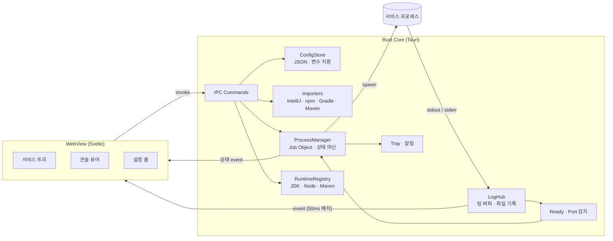

# Services Dashboard 기획서

> 문서 버전 0.4 · 2026-11-19 · 진행 상황: M0~M3 완료, M4 예정

IntelliJ를 켜지 않고도 로컬 개발 서비스(Node, Spring Boot, Maven, Gradle, 임의 명령)를 한 화면에서 띄우고, 끄고, 로그를 보는 **가벼운 데스크톱 서비스 대시보드**.

---

## 목차

1. [배경과 문제](#1-배경과-문제)
2. [목표와 비목표](#2-목표와-비목표)
3. [사용자와 시나리오](#3-사용자와-시나리오)
4. [화면 설계](#4-화면-설계)
5. [기능 명세](#5-기능-명세)
6. [설정 우선 원칙 (소스 수정 없이 해결하기)](#6-설정-우선-원칙-소스-수정-없이-해결하기)
7. [아키텍처](#7-아키텍처)
8. [비기능 요구사항](#8-비기능-요구사항)
9. [마일스톤](#9-마일스톤)
10. [리스크와 대응](#10-리스크와-대응)
11. [부록](#11-부록)

---

## 1. 배경과 문제

로컬 개발에서는 프론트엔드(npm) 여러 개와 백엔드(Spring Boot) 여러 개를 동시에 띄우는 일이 흔하다. 지금은 주로 IntelliJ의 **Services** 탭에 기대고 있다.

| 문제 | 내용 |
|---|---|
| IDE가 무겁다 | 서비스만 띄우려 해도 IntelliJ를 켜야 한다. 인덱싱과 수 GB의 메모리를 치른다. |
| 설정이 흩어져 있다 | `.run/*.run.xml`, `.idea/workspace.xml`, `package.json` scripts, `application-*.yml` 프로파일, 환경변수, JDK·Node 경로가 프로젝트와 PC 곳곳에 퍼져 있다. |
| 터미널 방식은 관리가 어렵다 | 터미널 창을 여러 개 띄우면 어떤 창이 어떤 서비스인지 헷갈리고, 창을 닫아도 자식 프로세스가 남아 포트를 점유한다. |
| 버전 혼재 | PATH의 `java`와 `JAVA_HOME`의 버전이 다르거나 프로젝트마다 요구하는 JDK·Node 버전이 다르다. |
| 한글 로그 깨짐 | Windows 콘솔 기본 인코딩(CP949)과 UTF-8 출력이 섞여 로그가 깨진다. |

## 2. 목표와 비목표

### 목표

| ID | 목표 | 측정 기준 |
|---|---|---|
| G1 | IDE 없이 node / java / maven / gradle / 임의 명령 서비스를 원클릭으로 실행·중지·재시작 | IntelliJ를 켜지 않고 기존에 쓰던 서비스 전부 기동 |
| G2 | **좌측 서비스 트리 + 우측 콘솔 로그** 레이아웃 (IntelliJ Services와 같은 감각) | 서비스 선택 즉시 해당 콘솔 표시 |
| G3 | 이미 만들어 둔 설정 가져오기 (IntelliJ 실행 구성, package.json, Spring Boot 프로젝트) | 폴더 하나 선택 → 감지 목록 체크 → 추가까지 1분 이내 |
| G4 | 흩어진 설정(환경변수, 프로파일, JDK·Node 버전, 포트)을 한 화면에서 관리 | 서비스 설정을 위해 다른 파일을 열 필요 없음 |
| G5 | 가벼움 | 설치 파일 15MB 이하, 대기 메모리 100MB 이하 (서비스 프로세스 제외) |
| G6 | 프로젝트 소스 수정 없이 **설정으로** 해결 | 대시보드 때문에 `build.gradle`, `pom.xml`, `application.yml`을 고치는 일이 없음 |

### 비목표

- 소스 코드 열람·편집, 빌드 결과 분석, 테스트 러너 UI
- 디버거 UI (대신 **디버그 포트를 열어 실행**하는 옵션을 제공해 IntelliJ/VS Code에서 attach)
- 원격 서버 배포·운영 모니터링
- 컨테이너 오케스트레이션 (단, `docker compose up` 같은 명령은 `shell` 타입으로 실행 가능)

## 3. 사용자와 시나리오

**대상 사용자**: 멀티 모듈 프로젝트를 로컬에서 띄워 개발하는 웹 개발자 (Spring Boot + Vue/React 조합).

| # | 시나리오 | 흐름 |
|---|---|---|
| S1 | 아침 출근 | 앱 실행 → `server` 그룹 **전체 시작** → 인증 서버가 준비되면 포털이 자동으로 이어서 시작 → 창을 닫아 트레이로 내림 |
| S2 | 새 프로젝트 가져오기 | **가져오기** → 프로젝트 폴더 선택 → 감지 결과(IntelliJ 실행 구성 12개, npm 스크립트 6개, Spring Boot 앱 4개)에서 체크 → 추가 |
| S3 | 같은 앱을 다른 프로파일로 | 서비스 **복제** → 프로파일 `local` → `pa`, 포트 8081로 변경 → 두 개 동시 실행 |
| S4 | 포트 충돌 | 시작 시 "8080 사용 중: java.exe (PID 1234)" 안내 → **종료 후 시작** 클릭 |
| S5 | 에러 추적 | 콘솔에서 `ERROR` 레벨만 필터 → 스택트레이스 확인 → 로그 파일로 저장 |
| S6 | JDK 버전이 다른 레거시 | 서비스 설정에서 JDK를 1.8로 지정 → 시스템 `JAVA_HOME`은 그대로 두고 그 서비스만 1.8로 실행 |

## 4. 화면 설계

### 4.1 메인 화면

```
+--------------------------------------------------------------------------------+
| Services Dashboard     [Workspace: my-project v]                  [설정] - [] X |
+------------------------------+-------------------------------------------------+
| [+] [Import] [>>] [■■]       | portal   ● 실행중   :5173   [브라우저 열기]     |
| [ filter...              ]   | [▶] [■] [⟳] [Debug]      | 콘솔 | 설정 | 정보 |  |
|                              +-------------------------------------------------+
| v npm               2/5      | [검색...] [필터] [ERROR][WARN] [저장][지우기][⇣] |
|     ● portal       :5173     +-------------------------------------------------+
|     ● sso          :5174     |   VITE v5.4.0  ready in 812 ms                  |
|     ○ admin                  |   ➜  Local:   http://localhost:5173/            |
|     ✕ mobile      exit 1     |   ...                                           |
| v server            1/3      |                                                 |
|     ◐ PortalApi    starting  |                                                 |
|     ● AuthApi      :8081     |                                                 |
|     ○ BatchApp               |                                                 |
| > temp                       |                                                 |
+------------------------------+-------------------------------------------------+
| 실행 3 / 전체 9  ·  서비스 메모리 합계 2.1 GB                          v0.1.0   |
+--------------------------------------------------------------------------------+
```

**상태 아이콘**: `●` 실행중(초록) · `◐` 시작중/준비 대기(노랑) · `○` 중지(회색) · `✕` 실패·비정상 종료(빨강) · `⟳` 재시작중

### 4.2 좌측: 서비스 트리

- 그룹(폴더) → 서비스 2단 구조. 그룹 행에 `실행 수/전체 수` 표시. (IntelliJ의 `folderName`과 같은 개념)
- 서비스 행: 상태 아이콘, 이름, 감지된 포트(또는 종료 코드)
- 드래그 앤 드롭으로 순서 변경·그룹 이동, 다중 선택 후 일괄 시작/중지
- 상단 필터: 이름·태그 검색, "실행중만 보기" 토글
- 우클릭 메뉴: 시작 / 중지 / 재시작 / 디버그로 시작 / 복제 / 편집 / 삭제 / 작업 폴더 열기 / 여기서 터미널 열기 / 로그 파일 열기
- 그룹 우클릭: 그룹 전체 시작 / 중지 / 재시작, 그룹 환경변수 편집

### 4.3 우측: 서비스 상세 (탭)

| 탭 | 내용 |
|---|---|
| **콘솔** (기본) | 실시간 로그. 상세 기능은 [5.6](#56-콘솔-로그) |
| **설정** | 서비스 정의 폼 (타입별 필드). 저장하면 다음 실행부터 반영, "저장 후 재시작" 버튼 제공 |
| **정보** | PID, 시작 시각, 가동 시간, 실제 실행된 명령줄(변수 치환 후), **최종 환경변수와 각 값의 출처**, 메모리·CPU |

### 4.4 설정 화면 (앱 전역)

- **런타임**: 감지된 JDK / Node / Maven / Gradle 목록, 별칭(예: `17`, `1.8`, `node20`) 지정, 수동 추가
- **일반**: 창 닫기 동작(트레이로/종료), 윈도우 시작 시 자동 실행, 앱 시작 시 자동 시작할 그룹, 앱 종료 시 서비스 처리, 테마(다크/라이트/시스템), 언어(한국어/English)
- **로그**: 서비스별 버퍼 줄 수, 로그 파일 저장 여부·경로·보관 기간
- **워크스페이스 변수**: `${var:ROOT}` 같은 공통 변수와 공통 환경변수

### 4.5 단축키 (IntelliJ 계열로 통일)

| 동작 | 키 |
|---|---|
| 선택 서비스 시작 | `Shift+F10` |
| 디버그로 시작 | `Shift+F9` |
| 중지 | `Ctrl+F2` |
| 재시작 | `Ctrl+F5` |
| 콘솔 검색 | `Ctrl+F` |
| 콘솔 지우기 | `Ctrl+L` |
| 서비스 필터로 이동 | `Ctrl+K` |

## 5. 기능 명세

### 5.1 서비스 타입 (Runner)

| 타입 | 용도 | 핵심 설정 | 실제 실행 예 |
|---|---|---|---|
| `npm` | npm / yarn / pnpm 스크립트 | 디렉터리, 스크립트, 패키지 매니저, Node 런타임 | `npm run dev` |
| `node` | node 스크립트 직접 실행 | 엔트리 파일, node 옵션, 인자 | `node server.js` |
| `gradle-boot` | Spring Boot (Gradle) | 루트 디렉터리, 프로젝트 경로(`:apps:portal`), 프로파일, VM 옵션, 인자, JDK | `gradlew :apps:portal:bootRun -I <주입스크립트> --args="..."` |
| `maven-boot` | Spring Boot (Maven) | 루트 디렉터리, 모듈, 프로파일, VM 옵션, 인자, JDK | `mvn -pl portal spring-boot:run -Dspring-boot.run.profiles=local -Dspring-boot.run.jvmArguments="..."` |
| `java-main` | 메인 클래스 직접 실행 (빠른 기동) | 메인 클래스, 클래스패스 출처(gradle/maven 자동 해석), VM 옵션, 인자, JDK | `java @classpath.argfile com.example.App` |
| `jar` | 실행 가능한 jar | jar 경로, VM 옵션, 인자, JDK | `java -jar app.jar` |
| `gradle` | 임의 Gradle 태스크 | 태스크, 옵션 | `gradlew :batch:run` |
| `maven` | 임의 Maven 골 | 골, 옵션, 모듈 | `mvn -pl batch exec:java` |
| `shell` | 그 외 모든 명령 | 명령, 셸(cmd / PowerShell / bash) | `docker compose up`, `python app.py` |

### 5.2 서비스 공통 설정 항목

| 항목 | 설명 |
|---|---|
| `id`, `name`, `group`, `tags` | 식별자, 표시 이름, 소속 그룹, 교차 분류 태그 |
| `type` + 타입별 블록 | 위 표의 타입과 그 전용 설정 |
| `cwd` | 작업 디렉터리 (변수 사용 가능) |
| `env`, `envFiles` | 환경변수, `.env` 파일 경로 목록 |
| `runtime` | 사용할 JDK / Node (런타임 별칭 또는 절대 경로) |
| `jvmArgs`, `args` | VM 옵션, 프로그램 인자 |
| `spring.profiles` | 활성 프로파일 (타입에 맞게 인자로 변환) |
| `ports` | 사용 포트 (충돌 검사와 표시용, 비워 두면 로그에서 자동 감지) |
| `readiness` | 준비 완료 판정: 로그 정규식 / 포트 오픈 / HTTP 헬스 URL |
| `dependsOn` | 먼저 준비돼야 하는 서비스 목록 |
| `preLaunch` | 실행 전 작업 (예: `node_modules`가 없으면 `npm install`) |
| `autoRestart` | 비정상 종료 시 재시작 횟수·간격 |
| `encoding` | 출력 인코딩 (자동 / UTF-8 / CP949) |
| `debug` | 디버그 포트 (Java: JDWP, Node: `--inspect`) |
| `source` | 가져온 출처 (파일과 구성 이름). "다시 동기화"에 사용 |
| `notes` | 메모 |

### 5.3 설정 가져오기 (Import)

프로젝트 폴더를 선택하면 아래 출처를 스캔해 **서비스 후보 목록**을 보여 준다. 사용자가 체크한 것만 추가한다. 원본 파일은 **읽기만 하고 절대 수정하지 않는다.**

| 출처 | 위치 | 변환 결과 |
|---|---|---|
| IntelliJ Spring Boot 구성 (`SpringBootApplicationConfigurationType`) | `.idea/workspace.xml`의 `RunManager`, `.run/*.run.xml` | `gradle-boot` / `maven-boot` (빌드 도구 자동 판별) 또는 `java-main` |
| IntelliJ Application 구성 (`Application`) | 같음 | `java-main` 기본, `gradle-boot`로 전환 가능 |
| IntelliJ npm 구성 (`js.build_tools.npm`) | 같음 | `npm` |
| IntelliJ Jar / Maven / Gradle / Shell Script 구성 | 같음 | `jar` / `maven` / `gradle` / `shell` |
| IntelliJ `folderName` 속성 | 같음 | 그룹 |
| IntelliJ Compound 구성 | 같음 | 실행 프리셋 |
| `package.json` | 하위 폴더 스캔 (`node_modules` 제외) | `scripts` 중 `dev`, `start`, `serve`를 우선 추천 |
| Spring Boot 프로젝트 | `build.gradle(.kts)`, `pom.xml` | Boot 플러그인이 있는 모듈마다 후보 생성, `application-*.yml`/`.properties`에서 프로파일 후보 추출 |
| VS Code (2차) | `.vscode/launch.json` | `node` / `java-main` |

**IntelliJ 구성 변환 규칙**

| IntelliJ 항목 | 변환 |
|---|---|
| `SPRING_BOOT_MAIN_CLASS`, `MAIN_CLASS_NAME` | 메인 클래스 |
| `<module name="root.apps.portal.main"/>` | Gradle 모듈 이름 규칙(`<루트>.<경로...>.<소스셋>`)을 풀어 프로젝트 경로 `:apps:portal`로 변환. Maven이면 artifactId로 모듈 디렉터리를 찾아 `-pl` 값으로 변환 |
| `ACTIVE_PROFILES` | `spring.profiles` |
| `VM_PARAMETERS` | `jvmArgs` |
| `PROGRAM_PARAMETERS` | `args` |
| `<envs>` | `env` |
| `ALTERNATIVE_JRE_PATH` | `runtime.jdk` |
| 프로젝트 SDK (`.idea/misc.xml`의 `project-jdk-name`) | IntelliJ 전역 설정 `jdk.table.xml`에서 실제 경로를 찾아 `runtime.jdk`로 지정 |
| `WORKING_DIRECTORY`의 매크로 | `$PROJECT_DIR$`, `$MODULE_DIR$`, `$MODULE_WORKING_DIR$`, `$USER_HOME$`를 실제 경로로 치환 |
| `<package-json>`, `<scripts>`, `<package-manager>` | `cwd`, `npm.script`, `npm.packageManager` |

**가져오기 흐름**

1. 폴더 선택 → 스캔 (수 초 이내)
2. 미리보기: 출처별 후보 목록, 변환된 명령줄 미리보기, 이미 있는 서비스와 이름이 겹치면 덮어쓰기 / 건너뛰기 / 이름 바꾸기 선택
3. 추가 → 그룹은 `folderName`을 따르고, 없으면 출처 이름으로 생성
4. 이후 원본 구성이 바뀌면 서비스 우클릭 → **다시 동기화**

### 5.4 프로세스 관리

- **실행**: 변수 치환과 환경변수 병합을 마친 명령을 작업 디렉터리에서 실행. stdout과 stderr를 파이프로 받는다 (stderr는 구분 표시).
- **프로세스 트리 묶기 (Windows Job Object)**: 서비스마다 Job Object를 만들어 자식·손자 프로세스까지 묶는다.
  - 중지하면 트리 전체가 확실히 종료된다 (`npm` → `node` → `esbuild` 같은 하위 프로세스 포함).
  - 대시보드가 비정상 종료돼도 고아 프로세스가 남아 포트를 붙잡지 않는다 (`KILL_ON_JOB_CLOSE`).
  - 옵션 "대시보드를 종료해도 서비스 유지"를 켜면 이 동작을 끈다.
- **중지 절차**: ① 정상 종료 시도 (`CTRL_BREAK` 이벤트, Spring Boot는 actuator shutdown URL을 설정하면 호출) → ② 유예 시간(기본 5초) 뒤 트리 강제 종료
- **상태 머신**

  ```
  중지 ──시작──▶ 시작중 ──준비 감지──▶ 실행중 ──중지──▶ 중지중 ──▶ 중지
                  │                      │
                  └──────종료(코드≠0)────┴──▶ 실패 / 비정상 종료 ──(autoRestart)──▶ 시작중
  ```

- **준비(Ready) 감지**: 아래 중 하나 이상 설정. 타입별 기본값을 제공한다.
  - 로그 정규식: Spring Boot `Started \S+ in [\d.]+ seconds`, Vite `Local:\s+https?://`, Next.js `Ready in`, …
  - 포트 오픈 확인 (TCP connect)
  - HTTP 헬스 URL (예: `/actuator/health`가 200 응답)
- **포트 자동 감지**: 로그의 `Tomcat started on port 8080`, `http://localhost:5173` 같은 패턴에서 포트와 URL을 추출해 트리에 표시하고 **브라우저 열기** 버튼을 만든다.
- **포트 충돌 검사**: 시작 전에 `ports`를 검사해 점유 중이면 점유 프로세스(PID, 실행 파일 이름)를 보여 주고 **종료 후 시작** / **취소**를 묻는다.
- **자동 재시작**: 비정상 종료 시 N회까지 점점 늘어나는 간격으로 재시작
- **사전 작업(preLaunch)**: 예) `node_modules`가 없으면 `npm install`, 빌드 태스크 선행 실행
- **리소스 표시**: 서비스별 프로세스 트리 합산 메모리·CPU를 주기적으로 갱신

### 5.5 그룹과 일괄 실행

- 그룹(폴더) 단위 **전체 시작 / 중지 / 재시작**
- **의존성 순서 실행**: `dependsOn`으로 의존 그래프를 만들고, 의존 대상이 **준비 완료**된 뒤 다음 서비스를 시작한다. 순환 의존은 저장할 때 오류로 알린다.
- **실행 프리셋**: "백엔드만", "풀스택"처럼 그룹과 상관없이 서비스 묶음을 저장해 한 번에 실행 (IntelliJ Compound에 해당)

### 5.6 콘솔 로그

| 기능 | 설명 |
|---|---|
| 링 버퍼 | 서비스별 최근 N줄 보관 (기본 20,000줄, 설정 가능) |
| 가상 스크롤 | 화면에 보이는 줄만 렌더링해 대량 로그에도 부드럽게 동작 |
| ANSI 색상 | Spring Boot, Vite 등의 컬러 로그를 그대로 렌더링. stderr는 별도 색으로 구분 |
| 검색 | `Ctrl+F`, 정규식·대소문자 옵션, 이전/다음 일치 이동 |
| 필터 모드 | 검색어가 들어간 줄만 표시 |
| 레벨 하이라이트·빠른 필터 | `ERROR` / `WARN` / `INFO` 줄 강조, 클릭 한 번으로 해당 레벨만 표시 |
| 스택트레이스 접기 | 연속된 `at ...` 줄을 접었다 펴기 |
| 자동 스크롤 | 맨 아래에 있을 때만 따라감. 위로 스크롤하면 멈추고 "새 로그 N줄 ⇣" 버튼 표시 |
| 보기 옵션 | 줄바꿈 토글, 수신 시각 표시 토글, 글꼴 크기 |
| 작업 | 지우기, 선택 복사, 파일로 저장, URL 클릭 시 브라우저 열기 |
| 로그 파일 영속화 | 옵션. `logs/<서비스>/<날짜>.log`, 보관 기간 설정 |
| 인코딩 | 서비스별 출력 인코딩(자동 / UTF-8 / CP949). Java 서비스에는 한글 깨짐 방지 옵션(`-Dfile.encoding=UTF-8 -Dstdout.encoding=UTF-8 -Dstderr.encoding=UTF-8`, JDK 17 이하는 `-Dsun.stdout.encoding=UTF-8 -Dsun.stderr.encoding=UTF-8`)을 기본으로 주입 |
| 색상 강제 | 파이프로 실행하면 도구들이 색상을 끄므로 Node 계열은 `FORCE_COLOR=1`, Spring Boot는 `--spring.output.ansi.enabled=always`를 기본으로 주입 (끌 수 있음) |
| 표준 입력 | 하단 입력창으로 stdin 전송 (선택 기능) |
| 통합 뷰 (2차) | 여러 서비스 로그를 시간순으로 한 화면에 병합, 서비스명 접두사를 색으로 구분 |

### 5.7 런타임 관리 (JDK / Node / 빌드 도구)

- **자동 감지**
  - JDK: `JAVA_HOME`, `C:\Program Files\Java\*`, `C:\Program Files\Eclipse Adoptium\*`, Zulu, Amazon Corretto, `%USERPROFILE%\.jdks\*` (IntelliJ가 내려받은 JDK), IntelliJ `jdk.table.xml`
  - Node: PATH, nvm-windows(`%NVM_HOME%`), Volta, fnm
  - Maven: `MAVEN_HOME`, PATH, IntelliJ 번들 Maven
  - Gradle: 프로젝트의 Gradle Wrapper(`gradlew`)를 우선 사용
- 각 런타임의 버전을 실행해 확인하고 별칭(`17`, `1.8`, `node20`)을 붙인다.
- 서비스별로 런타임을 지정하면 **그 프로세스에만** `JAVA_HOME`과 `PATH` 앞부분을 바꿔 실행한다. 시스템 환경변수는 건드리지 않는다.

### 5.8 설정 저장과 변수

- **저장 위치**: `%APPDATA%\ServicesDashboard\`
  - `settings.json`: 앱 전역 설정 (런타임 목록, 창·로그 옵션)
  - `workspaces\<이름>.json`: 서비스 정의. 워크스페이스를 여러 개 두고 상단에서 전환 (예: 회사 프로젝트 / 개인 프로젝트)
- **변수**: 워크스페이스 변수 `${var:ROOT}`, 환경변수 `${env:USERPROFILE}`, 내장 변수 `${workspaceDir}`, `${userHome}`
- **환경변수 계층** (뒤가 우선): 시스템 → 워크스페이스 공통 → 그룹 → `envFiles` → 서비스 `env`. **정보** 탭에서 최종 값과 출처를 확인한다.
- **프로젝트 공유 파일 (선택)**: 워크스페이스 일부를 프로젝트 루트의 `services-dashboard.json`으로 내보내 팀과 공유. 개인 값은 `services-dashboard.local.json`으로 분리.
- **민감 정보**: 이름에 `PASSWORD`, `SECRET`, `TOKEN`, `KEY`가 들어간 환경변수는 화면에서 마스킹. 2차로 Windows 자격 증명 관리자 저장 지원.
- **직접 편집**: JSON Schema를 제공해 에디터 자동완성으로 파일을 직접 고칠 수 있게 하고, 파일 변경을 감지해 즉시 다시 불러온다.

### 5.9 앱 셸

- 트레이 상주: 창을 닫으면 트레이로 (설정 가능). 트레이 메뉴에서 그룹별 시작/중지, 전체 중지, 열기, 종료
- 앱 종료 시 실행 중인 서비스 처리: 모두 종료(기본) / 확인 대화상자
- Windows 토스트 알림: 준비 완료, 비정상 종료
- 윈도우 시작 시 자동 실행, 앱 시작 시 지정 그룹 자동 시작 (옵션)
- 다크 / 라이트 테마, 한국어 / English
- 단일 인스턴스 (두 번째 실행 시 기존 창을 앞으로)

## 6. 설정 우선 원칙 (소스 수정 없이 해결하기)

대시보드가 필요로 하는 것 때문에 프로젝트 소스를 고치지 않는다. 자주 겪는 요구는 다음처럼 **설정**으로 해결한다.

| 요구 | 소스 수정 대신 |
|---|---|
| 프로파일 변경 | `--spring.profiles.active=...` 인자 또는 `SPRING_PROFILES_ACTIVE` 환경변수 |
| 포트 변경 | Spring `--server.port=8081`, Vite `--port 5174`, 일반 `PORT` 환경변수 |
| 설정값 덮어쓰기 | Spring 환경변수 바인딩(`SPRING_DATASOURCE_URL=...`), `--key=value` 인자, `SPRING_APPLICATION_JSON` |
| Gradle `bootRun`에 VM 옵션 전달 | 대시보드가 만든 **Gradle init script**를 `-I`로 넘겨 `bootRun` 태스크에 주입 (`build.gradle` 수정 불필요) |
| Maven에 VM 옵션·인자 전달 | `-Dspring-boot.run.jvmArguments`, `-Dspring-boot.run.arguments`, `-Dspring-boot.run.profiles` |
| JDK·Node 버전 | 서비스별 런타임 지정 (해당 프로세스에만 적용) |
| 한글 깨짐 | 인코딩 옵션 자동 주입 + 서비스별 출력 인코딩 지정 |
| IntelliJ가 계산하던 클래스패스 | `java-main` 타입이 init script로 `runtimeClasspath`를 추출해 캐시하고 argfile로 실행 |

**Gradle init script 예시** (대시보드가 임시 폴더에 생성해 사용, 프로젝트에는 남기지 않음)

```groovy
// gradlew :apps:portal:bootRun -I %TEMP%\services-dashboard\inject.gradle --args="--server.port=8081"
allprojects {
    tasks.matching { it.name == 'bootRun' }.configureEach {
        def jvm = System.getenv('SD_JVM_ARGS')        // 대시보드가 프로세스 환경변수로 전달
        if (jvm) jvmArgs(jvm.split('\u001F') as List)  // 구분자: Unit Separator
    }
}
```

## 7. 아키텍처

### 7.1 기술 스택 선택

| 후보 | 설치 크기(대략) | 대기 메모리(대략) | 장점 | 단점 |
|---|---|---|---|---|
| **Tauri 2** (Rust + WebView2) | 5–10 MB | 40–80 MB | 가볍다. Job Object 같은 OS API를 직접 쓸 수 있다. 웹 UI로 화면을 빨리 만든다. | Rust 빌드 시간 |
| Electron | 100 MB 이상 | 150–300 MB | 개발이 쉽고 생태계가 크다 | 무겁다 (G5 위배) |
| JavaFX | JRE 포함 60 MB 이상 | 150 MB 이상 | Java 개발자에게 익숙 | 메모리, UI 생산성 |
| 로컬 웹서버 + 브라우저 | 작음 | 작음 | 단순 | 트레이·알림·창 경험이 약하고 브라우저 탭에 의존 |

**결정: Tauri 2 + Svelte 5 + TypeScript**

- 백엔드(Rust): 프로세스 관리, Job Object, 로그 버퍼, 설정 저장, 가져오기, 런타임 감지, 트레이
- 프론트엔드(Svelte 5 + Vite): 트리, 콘솔 뷰어(가상 스크롤 + ANSI 파서), 설정 폼
- Windows 11에는 WebView2가 기본 설치돼 있어 별도 런타임이 필요 없다.

### 7.2 구성도



### 7.3 로그 흐름

1. 프로세스 stdout / stderr → 서비스별 읽기 스레드
2. 인코딩 디코드 (UTF-8 / CP949) → 줄 단위 분리
3. 링 버퍼 저장 + (옵션) 파일 기록 + Ready / Port 패턴 검사
4. **50ms마다 모아서** UI로 이벤트 전송 (줄마다 IPC를 보내지 않음)
5. UI는 선택한 서비스의 화면에 보이는 범위만 렌더링. 서비스를 바꾸면 `get_logs(id, from, count)`로 필요한 범위만 요청

### 7.4 IPC 초안

| 구분 | 이름 | 설명 |
|---|---|---|
| Command | `workspace_load`, `workspace_save` | 워크스페이스 읽기/쓰기 |
| Command | `service_upsert`, `service_delete`, `service_duplicate` | 서비스 정의 관리 |
| Command | `service_start`, `service_stop`, `service_restart` | 실행 제어 (`debug` 옵션) |
| Command | `group_start`, `group_stop`, `preset_start` | 일괄 실행 |
| Command | `logs_get`, `logs_clear`, `logs_export` | 로그 조회·관리 |
| Command | `project_scan`, `project_import` | 가져오기 |
| Command | `runtimes_detect` | 런타임 감지 |
| Command | `port_check`, `process_kill` | 포트 충돌 처리 |
| Event | `service://state` | 상태 변경 (상태, PID, 포트, 종료 코드) |
| Event | `service://log` | 로그 배치 |
| Event | `service://metrics` | 메모리·CPU |

### 7.5 저장소 구조 (예정)

```
ServicesDashboard/
├─ docs/
│  └─ PLANNING.md            # 이 문서
├─ schema/
│  └─ workspace.schema.json  # 워크스페이스 JSON Schema
├─ examples/
│  └─ workspace.example.json
├─ src/                      # 프론트엔드 (Svelte 5 + TS)
│  ├─ lib/components/        # ServiceTree, ConsoleView, ServiceForm ...
│  ├─ lib/stores/
│  └─ App.svelte
└─ src-tauri/                # 백엔드 (Rust)
   ├─ src/
   │  ├─ config/             # 스키마, 저장, 변수 치환
   │  ├─ importers/          # intellij, npm, gradle, maven
   │  ├─ process/            # manager, job object, readiness, ports
   │  ├─ logs/               # 링 버퍼, 디코더, 파일 기록
   │  ├─ runtime/            # JDK / Node / Maven 감지
   │  └─ main.rs
   └─ tauri.conf.json
```

## 8. 비기능 요구사항

| 구분 | 요구 |
|---|---|
| 성능 | 앱 기동 1초 이내, 대기 메모리 100MB 이하(서비스 프로세스 제외), 설치 파일 15MB 이하 |
| 로그 처리량 | 서비스 하나가 초당 5,000줄을 내도 UI가 끊기지 않음 |
| 안정성 | 대시보드가 종료·크래시돼도 고아 프로세스 0개 (Job Object) |
| 호환성 | Windows 10/11 우선. OS 의존 코드는 모듈로 분리해 macOS/Linux 확장 여지 확보 |
| 보안·개인정보 | 설정은 로컬에만 저장, 외부 전송·텔레메트리 없음 |
| 배포 | GitHub Releases에 설치본(NSIS)과 포터블 zip, GitHub Actions로 빌드 |

## 9. 마일스톤

| 단계 | 범위 | 완료 기준 | 상태 |
|---|---|---|---|
| **M0 기반** | Tauri 2 + Svelte 프로젝트 구성, CI(Windows 빌드), 워크스페이스 JSON Schema | 빈 창이 뜨는 설치본이 Actions에서 빌드됨 | 완료 |
| **M1 MVP** | 좌측 트리 + 우측 콘솔, 서비스 추가/편집 폼, `npm` · `shell` · `gradle-boot` · `maven-boot` · `jar` 실행, 시작/중지/재시작, Job Object 트리 종료, ANSI 콘솔, 설정 저장 | **IntelliJ 없이 기존 서비스를 모두 띄우고 로그를 볼 수 있음** | 완료 |
| **M2 가져오기·런타임** | IntelliJ 실행 구성 가져오기, package.json·Spring Boot 스캔, JDK/Node/Maven 감지와 서비스별 지정, 인코딩·색상 자동 주입 | 프로젝트 폴더 선택 한 번으로 서비스 목록 구성 | 완료 |
| **M3 로그·운영 편의** | 검색·필터·레벨 필터·스택트레이스 접기, 준비 감지, 포트 감지와 브라우저 열기, 포트 충돌 처리, 트레이·알림, 로그 파일 | 하루 종일 켜 두고 쓸 수 있는 수준 | 완료 |
| **M4 고급** | 의존성 순서 실행, 실행 프리셋, 자동 재시작, 디버그 모드, `java-main` 빠른 기동, VS Code 가져오기, 통합 로그 뷰, 프로젝트 공유 파일 | IntelliJ Services 탭을 완전히 대체 | 예정 |

## 10. 리스크와 대응

| 리스크 | 대응 |
|---|---|
| Gradle `bootRun`은 명령줄로 VM 옵션을 받지 못함 | Gradle init script(`-I`)로 주입. 프로젝트 파일은 건드리지 않음 |
| IntelliJ `Application`/`Spring Boot` 구성은 IDE가 계산한 클래스패스에 의존 | 기본은 `gradle-boot`/`maven-boot`로 변환. 빠른 기동이 필요하면 `java-main`이 빌드 도구로 클래스패스를 추출해 캐시 |
| Windows에서 Ctrl+C 같은 정상 종료 신호 전달이 어려움 | `CTRL_BREAK` 시도 → 유예 후 트리 강제 종료. Spring Boot는 actuator shutdown 옵션 제공 |
| 콘솔 인코딩 혼재 (CP949 / UTF-8) | 서비스별 출력 인코딩 설정 + Java 인코딩 옵션 주입 |
| 파이프 실행 시 도구가 색상을 끄거나 출력을 버퍼링 | `FORCE_COLOR` 등 주입. 2차로 ConPTY(의사 터미널) 실행 모드 추가 |
| 대량 로그로 UI 부하 | 50ms 배치 전송 + 가상 스크롤 + 링 버퍼 상한 |
| 일부 Windows 10에 WebView2 미설치 | 설치본에 WebView2 부트스트래퍼 포함 |
| Gradle 데몬 기동 시간 | 기본은 `--no-daemon`(중지 시 앱까지 즉시 종료 보장). 서비스별로 데몬 재사용을 켤 수 있음. 반복 실행이 잦은 서비스는 `java-main`(M4) 권장 |
| 빌드 도구가 앱 출력을 재인코딩 (한글 깨짐) | Gradle·Maven JVM에도 `GRADLE_OPTS`·`MAVEN_OPTS`로 UTF-8 옵션을 넣어 앱·빌드 도구·대시보드의 인코딩을 맞춤 (M2에서 확인) |
| 외부(IntelliJ) Gradle 데몬에 붙으면 앱이 대시보드 Job 밖에서 실행됨 | `--no-daemon` 기본값으로 해결. 데몬 재사용 옵션에는 지연 가능성을 안내 |

## 11. 부록

### 11.1 워크스페이스 파일 예시

```json
{
  "$schema": "https://raw.githubusercontent.com/hulbo/ServicesDashboard/main/schema/workspace.schema.json",
  "name": "my-project",
  "variables": {
    "ROOT": "C:/Project/my-project"
  },
  "env": {
    "FORCE_COLOR": "1"
  },
  "groups": [
    { "id": "npm", "name": "npm" },
    { "id": "server", "name": "server", "env": { "SPRING_PROFILES_ACTIVE": "local" } }
  ],
  "services": [
    {
      "id": "portal-front",
      "name": "portal",
      "group": "npm",
      "type": "npm",
      "cwd": "${var:ROOT}/front/portal",
      "npm": { "script": "dev", "packageManager": "npm" },
      "runtime": { "node": "node20" },
      "readiness": { "logPattern": "Local:\\s+https?://" }
    },
    {
      "id": "auth-api",
      "name": "AuthApplication",
      "group": "server",
      "type": "gradle-boot",
      "cwd": "${var:ROOT}",
      "gradle": { "project": ":apps:auth" },
      "runtime": { "jdk": "17" },
      "ports": [8081],
      "readiness": { "httpUrl": "http://localhost:8081/actuator/health" }
    },
    {
      "id": "portal-api",
      "name": "PortalApplication (local)",
      "group": "server",
      "type": "gradle-boot",
      "cwd": "${var:ROOT}",
      "gradle": { "project": ":apps:portal" },
      "spring": { "profiles": ["local"] },
      "jvmArgs": ["--add-opens", "java.base/java.lang=ALL-UNNAMED"],
      "args": ["--server.port=8080"],
      "runtime": { "jdk": "17" },
      "ports": [8080],
      "dependsOn": ["auth-api"],
      "debug": { "port": 5005 },
      "source": { "kind": "intellij", "file": ".run/PortalApplication.run.xml", "name": "PortalApplication" }
    }
  ],
  "presets": [
    { "name": "풀스택", "services": ["auth-api", "portal-api", "portal-front"] }
  ]
}
```

### 11.2 IntelliJ 실행 구성 타입 대응표

| IntelliJ `type` | Services Dashboard 타입 |
|---|---|
| `SpringBootApplicationConfigurationType` | `gradle-boot` / `maven-boot` / `java-main` |
| `Application` | `java-main` (또는 `gradle-boot`) |
| `js.build_tools.npm` | `npm` |
| `NodeJSConfigurationType` | `node` |
| `JarApplication` | `jar` |
| `MavenRunConfiguration` | `maven` |
| `GradleRunConfiguration` | `gradle` |
| `ShConfigurationType` | `shell` |
| `CompoundRunConfigurationType` | 실행 프리셋 |

### 11.3 용어

| 용어 | 뜻 |
|---|---|
| 워크스페이스 | 서비스 정의 묶음 하나. 파일 하나로 저장 |
| 그룹 | 트리의 폴더. 일괄 실행 단위 |
| 실행 프리셋 | 그룹과 상관없이 고른 서비스 묶음 |
| 준비(Ready) | 서비스가 요청을 받을 수 있는 상태가 됐다고 판정된 시점 |
| 런타임 | 서비스 실행에 쓰는 JDK / Node / 빌드 도구 |
